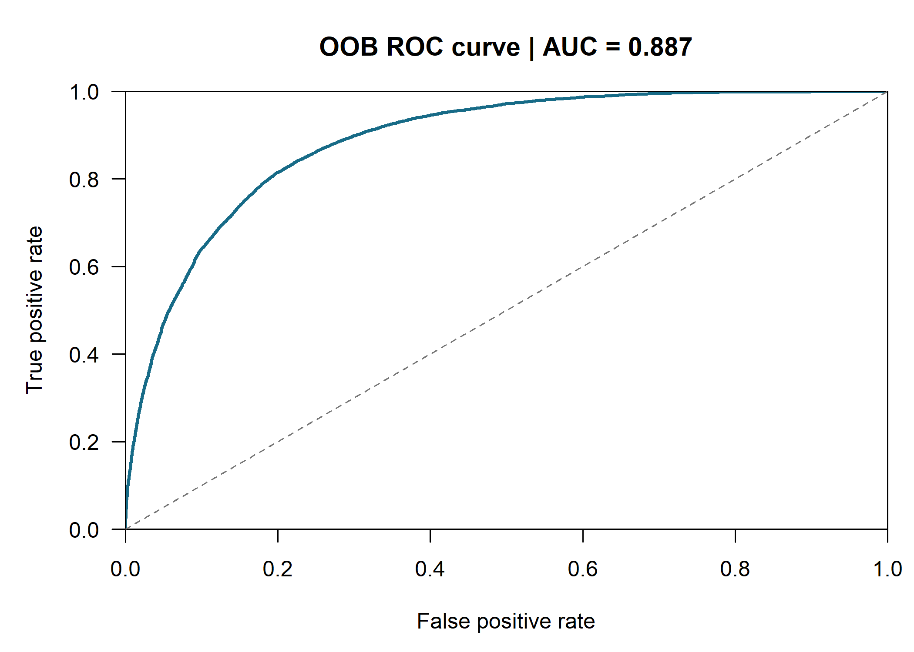
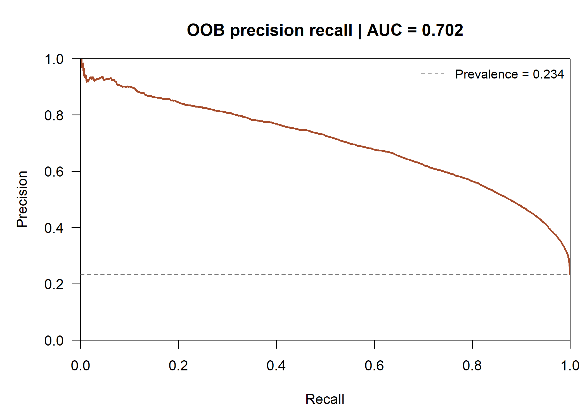

# m6APrediction


## Purpose and scientific use

**m6APrediction** applies the BIO215 teaching random forest to site-level
features and returns a Positive-class score and a thresholded m6A prediction.
The package supports reproducible prioritisation of candidate RNA
N6-methyladenosine sites for further investigation. It provides a batch
interface for feature tables and a single-site interface for exploratory use.

The package includes the course-supplied 500-tree model and a 100-row input
example. It performs inference only; it does not retrain the model during
installation or prediction. It requires no Shiny server or internet connection
after installation. Model outputs are research predictions and need independent
experimental validation before biological conclusions are drawn.

## Installation

### Install from GitHub

Install this publicly available package directly from its repository:

```r
install.packages("remotes", repos = "https://cloud.r-project.org")
remotes::install_github("qzt1237654/m6APrediction")
library(m6APrediction)
```

Repository: <https://github.com/qzt1237654/m6APrediction>

R 3.5.0 or later is declared for the model's RDS format; individual
 dependencies may require a newer R release. The package was tested using
R 4.4.3 on Windows and randomForest 4.7-1.2. Its own R code requires no
compilation. `remotes` is needed for installation from GitHub; the installed
package imports `randomForest` and `stats`.

### Install from a source archive

If using the alternative coursework archive `m6APrediction_1.0.0.tar.gz`,
install it locally by selecting that file:

```r
install.packages("randomForest", repos = "https://cloud.r-project.org")
install.packages(file.choose(), repos = NULL, type = "source")
library(m6APrediction)
```

Select the `.tar.gz` package archive rather than an HTML guide or a GitHub ZIP.

## Input requirements

Provide all seven fields using the following names and training scales.
Missing values and unsupported categories are rejected with an error.

| Field | Required content |
|:--|:--|
| `gc_content` | Finite numeric fraction between 0 and 1 |
| `RNA_type` | `mRNA`, `lincRNA`, `lncRNA` or `pseudogene` |
| `RNA_region` | `CDS`, `intron`, `3'UTR` or `5'UTR` |
| `exon_length` | Finite nonnegative value already on the course log2 scale |
| `distance_to_junction` | Finite nonnegative value already on the course log2 scale |
| `evolutionary_conservation` | Finite numeric value between 0 and 1 |
| `DNA_5mer` | Exactly five uppercase A/T/C/G bases; intended contexts have central A |

Use the course feature-generation conventions. Length and distance must not
be supplied as raw base-pair counts. The teaching files do not document every
upstream preprocessing choice, so transformations should not be guessed for
new biological datasets.

DNA positions are categorical factors with levels A, T, C and G, not one-hot
columns. The supplied forest uses positions 1, 2, 4 and 5. Position 3 is A in
the teaching data and is omitted from the fitted model. Predictions for other
central nucleotides are outside its demonstrated training domain.

## Minimal example for batch prediction

This example loads its own resources and can be run in a fresh R session.
`system.file()` locates files inside the installed package, without an `inst/`
prefix.


``` r
library(m6APrediction)
ml_fit <- readRDS(system.file("extdata", "rf_fit.rds",
                             package = "m6APrediction", mustWork = TRUE))
feature_df <- read.csv(system.file("extdata", "m6A_input_example.csv",
                                   package = "m6APrediction", mustWork = TRUE))
batch_result <- prediction_multiple(ml_fit, feature_df[1:3, ],
                                     positive_threshold = 0.6)
batch_result[, c("DNA_5mer", "predicted_m6A_prob", "predicted_m6A_status")]
```

```
##   DNA_5mer predicted_m6A_prob predicted_m6A_status
## 1    GAACA              0.876             Positive
## 2    GAACC              0.000             Negative
## 3    AAACT              0.498             Negative
```

The returned data frame retains input rows and extra columns such as site IDs.
`RNA_type` and `RNA_region` are converted to the factors expected by the model.
Two columns are added, or replaced if already present: numeric
`predicted_m6A_prob` and character `predicted_m6A_status`.

For a complete input file:


``` r
features <- read.csv(file.choose(), stringsAsFactors = FALSE)
results <- prediction_multiple(ml_fit, features, positive_threshold = 0.5)
write.csv(results, "predicted.csv", row.names = FALSE)
```

## Minimal example for single site prediction

This example also creates its own model object and runs independently.


``` r
library(m6APrediction)
ml_fit <- readRDS(system.file("extdata", "rf_fit.rds",
                             package = "m6APrediction", mustWork = TRUE))
single_result <- prediction_single(
  ml_fit, gc_content = 0.6, RNA_type = "mRNA", RNA_region = "CDS",
  exon_length = 12, distance_to_junction = 5,
  evolutionary_conservation = 0.8, DNA_5mer = "GGACA",
  positive_threshold = 0.5
)
single_result
```

```
##   predicted_m6A_prob predicted_m6A_status
##               "0.51"           "Positive"
```

The result is a **named character vector** of length two because R combines
the numeric score and text label into one vector. Convert the score with
`as.numeric(single_result["predicted_m6A_prob"])` when needed.

## Meaning of the score and threshold

`predicted_m6A_prob` is the proportion of trees voting Positive. It is not a
measured methylation fraction or a guaranteed calibrated probability. The
status is Positive only when the score is **strictly greater than**
`positive_threshold`; a score equal to the cutoff is Negative. Increasing the
cutoff changes class labels without changing the underlying scores.

## Model performance and limitations

The following figures are calculated from the **stored out-of-bag (OOB) votes**
in the bundled forest. For each training row, only trees that did not use that
row for fitting contribute to its OOB prediction. This is internal assessment;
it is not an independent external test cohort. The 100-row input example is
for demonstrating the software and must not be presented as a held-out test.


The supplied forest contains **500 trees**, with OOB votes for
**48,055 sites**. The Positive fraction is
**23.41%**, OOB error is
**16.11%**, ROC AUC is
**0.887**, and PR AUC is
**0.702**. Both areas use trapezoidal integration over
distinct score thresholds, grouping tied scores together.





These plots support the model's ability to rank sites within the supplied
teaching dataset. They do not establish generalisation to new experiments,
transcripts, individuals or species. Nearby or related sites may share
information even when individual rows are OOB. Unknown batch structure,
feature preprocessing and calibration limit interpretation. External validation
with appropriate grouping and experimental confirmation would be needed for
stronger biological claims. The package makes no diagnostic claims.

## Documentation and reproducibility


``` r
help("prediction_multiple", package = "m6APrediction")
help("prediction_single", package = "m6APrediction")
example("prediction_multiple", package = "m6APrediction")
example("prediction_single", package = "m6APrediction")
```

The source archive contains `R/main.R`, generated help files in `man/`,
`NAMESPACE`, `DESCRIPTION`, the model and example under `inst/extdata/`,
README source and figures, and base-R regression tests. The internal
`dna_encoding()` helper is documented but is not exported. Only the two
prediction functions are public.

The package passed **`R CMD check --no-manual` with Status: OK**
on R 4.4.3 on Windows: **0 errors, 0 warnings and 0 notes**. The check
installed the source package, ran both exported function examples, checked
documentation against the function arguments, and ran the included regression
tests. Reference results were 0.876, 0.000 and 0.498 for the first three batch
rows, and 0.51 / Positive for the single-site example. Tests also cover strict
cutoff equality, agreement between the two interfaces, preservation of extra
columns and rejection of invalid inputs.

To check an unpacked source package using development tools:


``` r
install.packages("devtools", repos = "https://cloud.r-project.org")
devtools::document()
devtools::check(args = "--no-manual", cran = FALSE)
```

`--no-manual` skips only PDF manual generation, which needs a LaTeX
installation. It does not skip function examples or package tests. The large
bundled random forest can produce an installed-size NOTE.

The equivalent command from a terminal, used for this submission, is:


``` bash
R CMD check --no-manual m6APrediction_1.0.0.tar.gz
```

## Author and attribution

Zhengtao Qi, student ID 2468844, BIO215 Interim Report 3.
Contact: Zhengtao.Qi24@student.xjtlu.edu.cn

The fitted `rf_fit.rds`, input example and original three prediction functions
were provided by Zhen Wei in the BIO215 Practical 6 materials. This package
adapts those functions with input validation, documentation and reproducible
examples. The model is supplied unchanged. The OOB figures above were
calculated directly from its stored votes; no new model training is claimed.
Package code is distributed under the MIT license, with the supplied teaching
materials explicitly attributed.
